# 🏙️ Tiny Empire Tycoon

Juego tycoon completo para Roblox: cada jugador recibe una parcela en una ciudad colorida y la convierte, negocio a negocio, de un puesto de limonada en un complejo empresarial con fábricas, laboratorio y rascacielos.

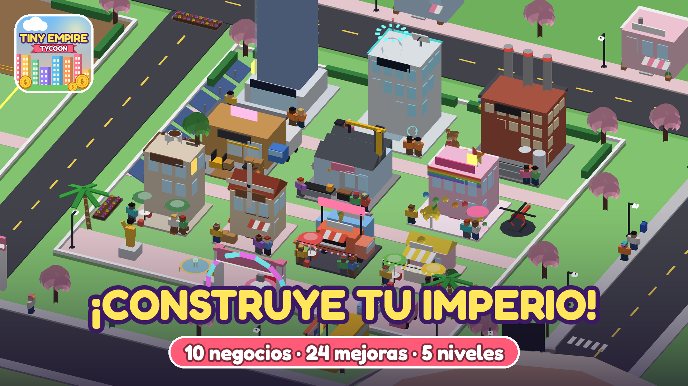

| Parcela con todo desbloqueado | Tema premium «Ciudad Dorada» |
|---|---|
| 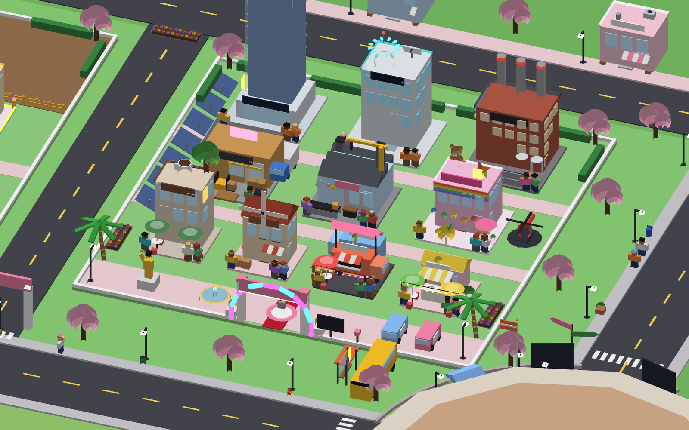 | 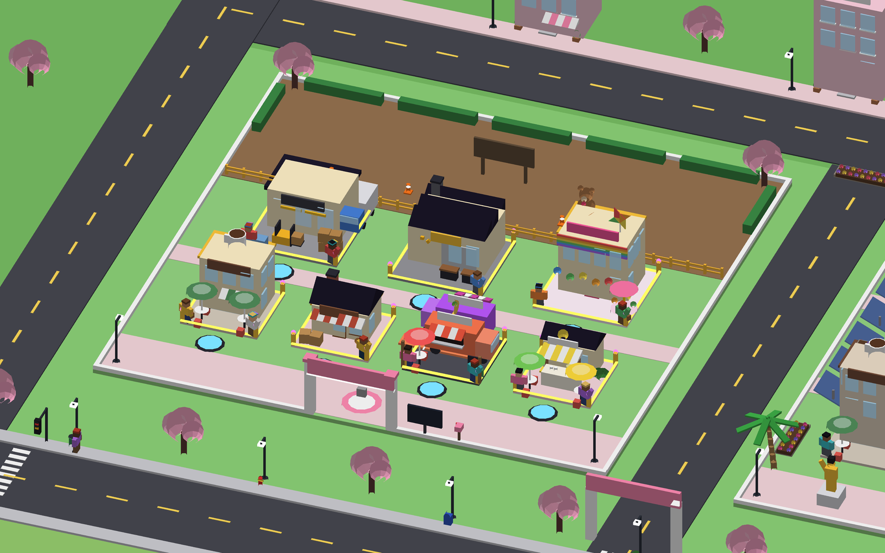 |

| HUD | Menú Imperio | Tienda |
|---|---|---|
| 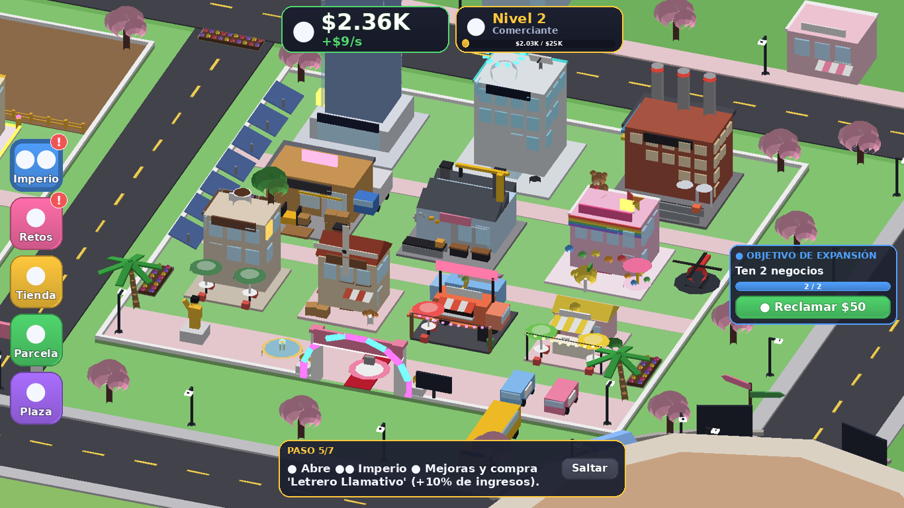 | 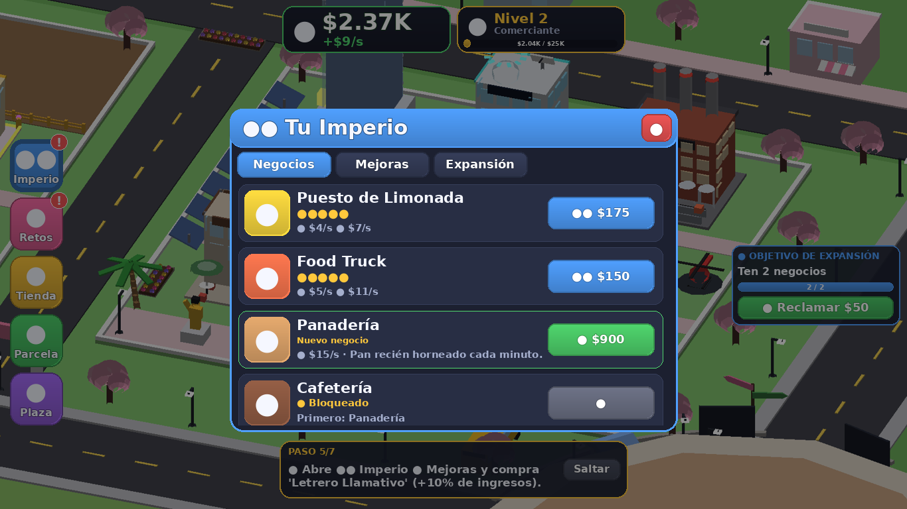 | 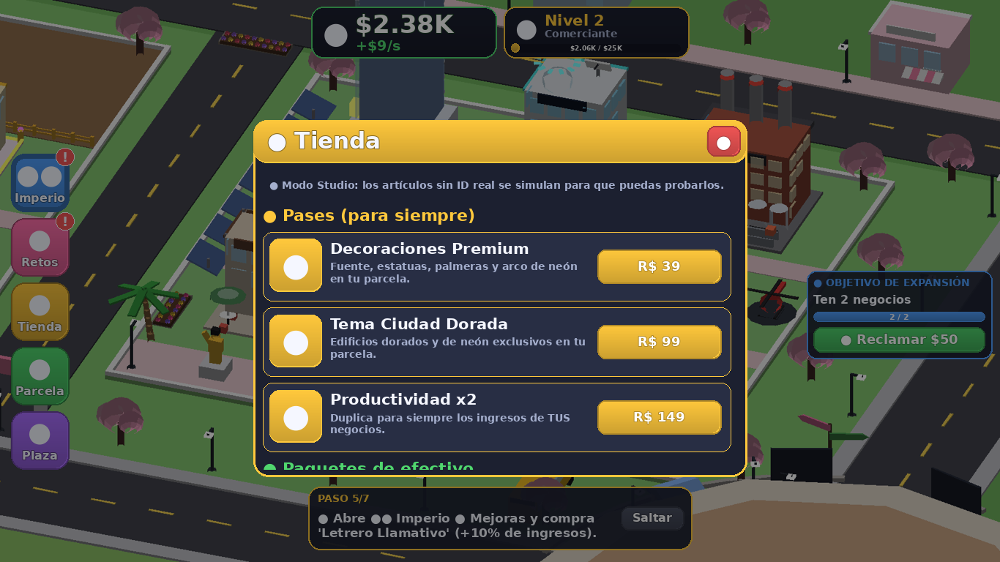 |

> Las imágenes son vistas previas generadas fuera de Roblox (`tools/render.py` y `tools/render_gui.py`) a partir del mundo y la interfaz reales que crean los scripts. Los emojis aparecen como círculos porque el renderizador no tiene fuente de emojis; en Roblox se ven correctamente.

---

## 🎬 Vídeo de presentación

[`assets/video_presentacion.mp4`](assets/video_presentacion.mp4) (43 s, 1280×720): construcción de una parcela en cámara rápida con el HUD, máquinas animadas, plaza con peatones, tráfico con semáforos y ciclo de noche. Está renderizado fuera de Roblox con `tools/make_video.py` a partir de los datos reales que generan los scripts (`tools/export_video.luau`); en Roblox la iluminación y las sombras son las del motor.

## 🎨 Imágenes incluidas (generadas para el juego)

Todas están en [`assets/`](assets) y se regeneran con `python3 tools/make_images.py build assets`. Están dibujadas por código (sin recursos de terceros) en 512×512 o 1920×1080, listas para subir.

| Icono del juego | Decoraciones Premium | Tema Ciudad Dorada | Productividad x2 |
|---|---|---|---|
| 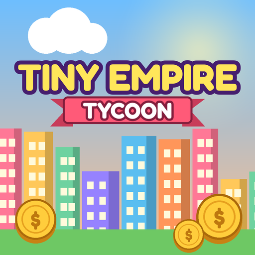 | 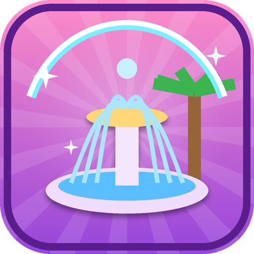 | 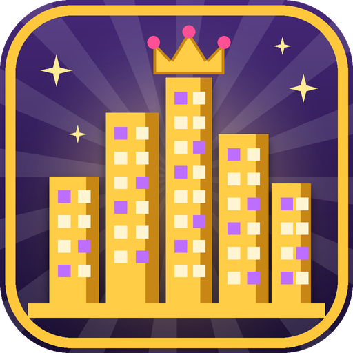 | 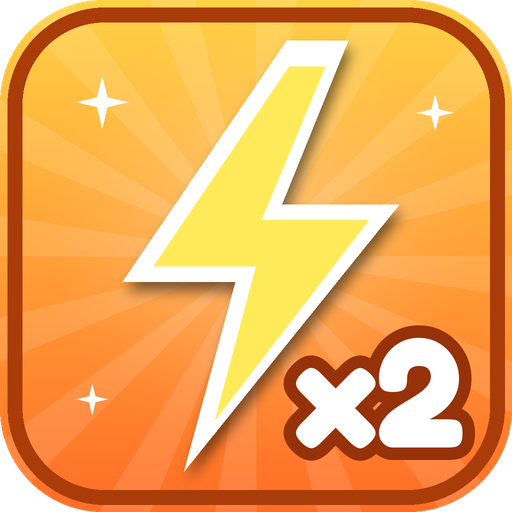 |

| Maletín (29 R$) | Caja Fuerte (49 R$) | Camión Blindado (79 R$) |
|---|---|---|
| 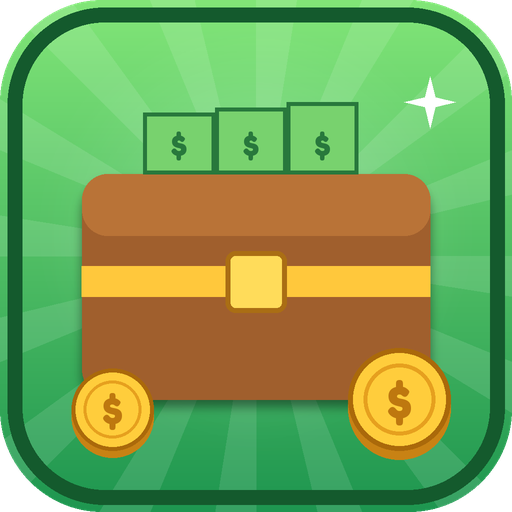 | 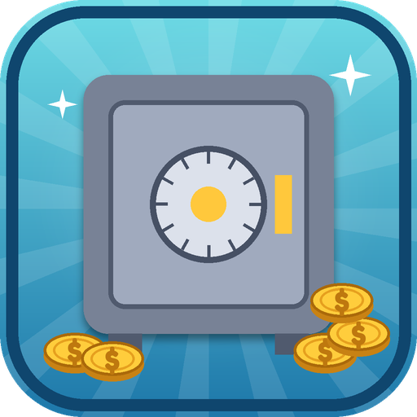 | 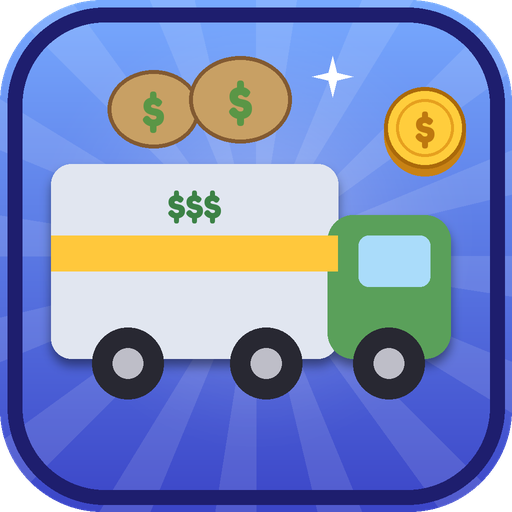 |

Miniaturas: [`miniatura_parcela.png`](assets/miniatura_parcela.png), [`miniatura_ciudad.png`](assets/miniatura_ciudad.png), [`miniatura_plaza.png`](assets/miniatura_plaza.png).

**Dónde usarlas**
- *Creator Dashboard → tu experiencia → Places/Configure → Icon* → `icono_juego.png`; *Thumbnails* → las 3 miniaturas.
- Al crear cada pase o producto, súbele su imagen. **La tienda del juego la muestra automáticamente** (la lee con `MarketplaceService:GetProductInfo`); mientras no haya ID se usa un emoji.

---

## ▶️ Prueba rápida (5 minutos)

1. Abre **`TinyEmpireTycoon.rbxl`** con Roblox Studio (doble clic o *File → Open from File*). La ciudad ya aparece construida en modo edición.
2. *(Opcional, para probar el guardado)* **File → Game Settings → Security → Enable Studio Access to API Services**. Para eso el lugar debe estar publicado (*File → Publish to Roblox*). Sin esto el juego funciona igual, pero avisa de que el progreso no se guarda.
3. Pulsa **Play** (F5). Al arrancar, el servidor regenera el mapa y monta parcelas, interfaz y sistemas.
4. Para probar varios jugadores: pestaña **Test → Clients and Servers → Local Server + 2/3 Players → Start**.

### Qué probar

| Prueba | Cómo |
|---|---|
| Parcela propia | Al entrar apareces en tu parcela; el cartel de la entrada y el letrero flotante muestran tu nombre. |
| Construir | Pisa el botón verde «¡GRATIS!» → aparece el Puesto de Limonada con animación de obra. |
| Economía automática | El contador sube solo; sobre los edificios salen «+$» flotantes. |
| Mejoras | Botones azules de la parcela (subir nivel) o menú 🏛️ **Imperio** → *Negocios / Mejoras / Expansión*. |
| Expansiones | Al llegar a nivel de imperio 3 aparece el botón dorado del **Distrito Comercial**. |
| Retos y objetivos | Menú 🎯 **Retos** (diarios + objetivos de expansión) y la tarjeta de la derecha. |
| Plaza social | Botón ⛲ **Plaza**: fuente, escenario con pista de baile, quioscos, ranking y maletines 💼 con dinero. |
| Tienda | Menú 🛒 **Tienda**. En Studio, con IDs a 0, las compras se **simulan** para que puedas probarlas. |
| Reingreso | Sal y vuelve a entrar (con API Services activado): se restauran negocios, mejoras y dinero, y recibes ganancias offline. |
| Protección | Con otro jugador, pisa los botones de una parcela ajena: no ocurre nada y aparece un aviso. |
| Día/noche | Ciclo de 14 min: farolas, ventanas y neones se encienden de noche. |

---

## 🎮 Contenido

**Mapa** (generado por código, ~4.800 piezas)
- Plaza central con fuente, mosaico, bancos, árboles, escenario «Zona Social» con pista de baile de neón, quioscos, arco de bienvenida, paneles «Cómo jugar» y «Ranking del servidor», autobús y maletines de bonificación.
- 4 barrios con estilo propio, cada uno con 2 parcelas (8 en total):
  - **Barrio Pastel**: cerezos en flor, colores pastel.
  - **Distrito Verde**: pinos, estanque y vallas de madera.
  - **Puerto Industrial**: muelle, contenedores y grúa portuaria animada.
  - **Costa Sol**: palmeras, playa con sombrillas y mar.
- Avenidas, anillo exterior con 12 vehículos que circulan, calles laterales, aceras, farolas, 16 tiendas decorativas (con aires acondicionados, depósitos de agua, antenas y macetas), casas, arboledas y colinas en el horizonte.
- Vida urbana: 28 peatones que caminan por la plaza y las aceras (con balanceo de brazos y piernas), clientes delante de cada negocio (más clientes cuanto más nivel), 8 semáforos que cambian de color, pasos de cebra, bocas de incendio, papeleras, buzones, macetas, parada de autobús, banderas que ondean y nubes que cruzan el cielo.
- **Físicas**: maletines que caen del cielo, rebotan y se asientan (y una *Lluvia de maletines* cada 5 min), trampolines con lona de muelle amortiguado, sprint con Shift o botón táctil (aceleración progresiva y apertura del campo de visión), monedas y escombros físicos que saltan al construir o cobrar (grupo de colisión propio: rebotan en el suelo pero no empujan a los jugadores).
- **Tráfico con conducción realista**: curvas redondeadas, aceleración y frenado con curva de frenado, distancia de seguridad, los coches paran en los semáforos del anillo (y deciden si pueden parar en ámbar) y frenan ante jugadores en la calzada; ruedas que giran, cabeceo al frenar, balanceo en curvas y luces de freno.
- **Animaciones**: peatones que aceleran, se paran a mirar, dan la vuelta al final de la acera y esquivan jugadores (con rebote al andar y cabeza que mira alrededor); obras que crecen planta a planta con rebote; máquinas que arrancan con inercia; banderas de tela por segmentos y árboles mecidos por ráfagas de viento; «+$» con trayectoria parabólica; botones de compra que laten.
- Pantalla de carga animada (skyline que crece, título con rebote y consejos).
- Señalización: arcos de barrio, postes indicadores, carteles de parcela y paneles informativos.

**Parcelas** (120×120 studs, 3 zonas)
- 10 negocios que crecen visualmente en 5 niveles: Puesto de Limonada, Food Truck, Panadería, Cafetería, Juguetería, Taller, Almacén, Fábrica, Laboratorio Tech y Torre Corporativa.
- Animaciones: molinos, engranajes, cintas transportadoras, carretilla elevadora, ascensor de cristal, radar, hologramas, carrusel, grúas, humo de chimeneas, neones, osito y taza gigantes flotantes…
- Mejoras visuales: furgonetas de reparto, paneles solares, helipuerto con helicóptero y estatua dorada del fundador.
- Las zonas bloqueadas se ven como solar en obras con valla, conos y cartel.

**Sistemas**
- Economía automática cada segundo con multiplicadores por nivel, mejoras y franquicias.
- **24 mejoras de imperio** en 4 niveles + **40 subidas de nivel** de negocios.
- **2 expansiones de parcela** y **14 objetivos de expansión** con premio.
- **3 retos diarios** por jugador (reinicio 00:00 UTC) con bonus por completarlos todos.
- **Franquicia** (reinicio opcional) con +50 % de ingresos permanente.
- Ganancias offline (20 % durante 2 h; 50 % y 4 h con la mejora «Gerente Nocturno»).
- Tutorial guiado de 7 pasos con haz de luz hasta el objetivo; se puede saltar.
- Ranking del servidor en la plaza y `leaderstats`.
- Guardado con DataStoreService: bloqueo de sesión, reintentos, autoguardado cada 60 s y guardado al cerrar.
- Protección: el servidor valida todas las acciones; solo el dueño puede usar los botones de su parcela; límite de 12 acciones/s por jugador.

**Monetización** (todo lo principal se consigue gratis; nada de pago afecta a otros jugadores)

| Artículo | Tipo | Precio | Efecto |
|---|---|---|---|
| Decoraciones Premium | Pase | 39 R$ | Arco de neón, fuente, leones dorados, palmeras, jardines y alfombra roja en tu parcela |
| Tema Ciudad Dorada | Pase | 99 R$ | Edificios de mármol y oro con luces violetas (se puede desactivar) |
| Productividad x2 | Pase | 149 R$ | Duplica los ingresos de **tus** negocios |
| Maletín de Efectivo | Producto | 29 R$ | 20 min de tus ingresos (mín. $2.500) |
| Caja Fuerte | Producto | 49 R$ | 45 min de tus ingresos (mín. $7.500) |
| Camión Blindado | Producto | 79 R$ | 90 min de tus ingresos (mín. $20.000) |

---

## 💰 Activar las compras reales

1. Publica el juego (*File → Publish to Roblox*).
2. En el [Creator Dashboard](https://create.roblox.com/dashboard/creations) → tu experiencia → **Monetization**:
   - **Passes**: crea 3 pases (Decoraciones Premium 39, Tema Ciudad Dorada 99, Productividad x2 149) y ponlos a la venta.
   - **Developer Products**: crea 3 productos (29, 49 y 79 Robux).
3. Copia cada ID en `src/shared/Config.luau` (o directamente en `ReplicatedStorage › TinyEmpireShared › Config` dentro de Studio):

```lua
Config.GamePasses = {
	decor = { id = 123456789, price = 39, ... },
	theme = { id = 123456790, price = 99, ... },
	x2    = { id = 123456791, price = 149, ... },
}
Config.Products = {
	small  = { id = 987654321, price = 29, ... },
	medium = { id = 987654322, price = 49, ... },
	large  = { id = 987654323, price = 79, ... },
}
```

Con un ID distinto de 0, el botón abre la compra real de Roblox. Los recibos se procesan **solo en el servidor** (`MonetizationService`): cada `PurchaseId` se guarda en los datos del jugador y se guarda en DataStore antes de confirmar la compra, así que no hay duplicados aunque Roblox reintente. Si el guardado falla, el dinero se revierte y se devuelve `NotProcessedYet` para que Roblox lo reintente.

## ⚙️ Ajustes recomendados al publicar

- *Game Settings → Places → Max Players*: **8** (una parcela por jugador; el servidor expulsa con aviso a un noveno jugador si llegara a entrar).
- *Game Settings → Security*: activa **Enable Studio Access to API Services** para probar el guardado en Studio.
- Avatar R15 o R6: ambos funcionan.

---

## 🛠️ Desarrollo

El proyecto usa [Rojo](https://rojo.space). El archivo `TinyEmpireTycoon.rbxl` ya está compilado (con el mapa horneado); solo hace falta Rojo si quieres editar el código desde fuera de Studio (`rojo serve` y el plugin de Rojo).

```
default.project.json         Mapa de Rojo
src/shared/                  ReplicatedStorage.TinyEmpireShared
  Config.luau                Balance: negocios, mejoras, niveles, retos, productos e IDs
  Economy.luau               Lógica pura de economía (servidor y cliente)
  Format.luau                Formato de números ($1.25M) y tiempos
src/server/                  ServerScriptService.TinyEmpireServer
  Main.server.luau           Arranque
  World/                     Kit de piezas, paletas, edificios, parcelas y mapa
  Services/                  Datos, parcelas, juego, retos, compras, maletines, día/noche, ranking
src/client/                  StarterPlayerScripts.TinyEmpireClient
  Main.client.luau           Arranque del cliente y red
  UI/                        Tema, HUD y ventanas (Imperio, Retos, Tienda)
  Animator.luau              Animaciones del mundo, coches y «+$» flotantes
  Effects.luau               Confeti, dinero volando, destellos
  Tutorial.luau              Tutorial guiado con haz de luz
tests/                       Arnés de pruebas con Lune y simulación de balance
tools/                       Comprobación completa y renderizadores de vista previa
```

### Pruebas automáticas

```bash
./tools/check.sh
```

Descarga Rojo, Lune y luau-lsp, analiza todo el código con las definiciones de la API de Roblox, compila el lugar, ejecuta las pruebas y genera `TinyEmpireTycoon.rbxl` con el mapa horneado (`tools/bake.luau`). Pruebas:

- **`tests/run.luau`** — 178 comprobaciones (incluye físicas: trampolín, sprint, monedas, maletines, coches que frenan ante jugadores y respetan semáforos, peatones y banderas) ejecutando los scripts reales del juego en un motor simulado (instancias validadas contra la API de Roblox, tiempo virtual, DataStore y Marketplace simulados): creación del mundo y de parcelas, compras con botones y menús, mejoras, expansiones, objetivos, retos diarios y cambio de día, maletines, recibos sin duplicados (incluido fallo de guardado y reintento), pases, reingreso con datos restaurados y ganancias offline, bloqueo de sesión entre servidores, 8 jugadores simultáneos + expulsión del noveno, protección de parcelas, límites de peticiones, HUD/menús/tienda del cliente y 40 h de progresión gratis simulada.
- **`tests/run_nostore.luau`** — el juego funciona sin acceso a DataStore y avisa.
- **`tests/balance.luau`** — ritmo de progresión de un jugador eficiente: Food Truck ~1 min, primera expansión ~8 min, Fábrica ~1 h, Torre Corporativa ~3 h, franquicia ~6 h.

Para el análisis de diseño consulta [`docs/DISENO.md`](docs/DISENO.md).
